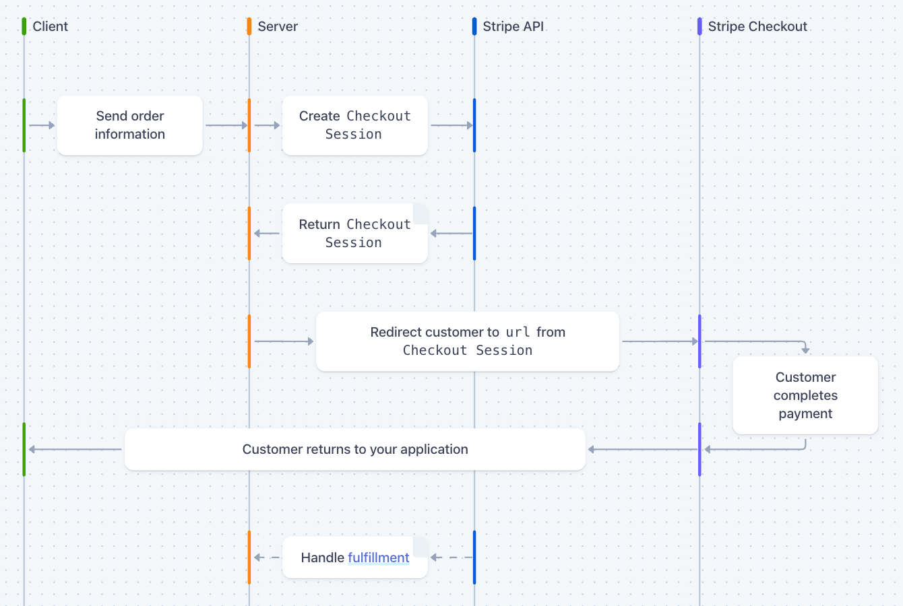
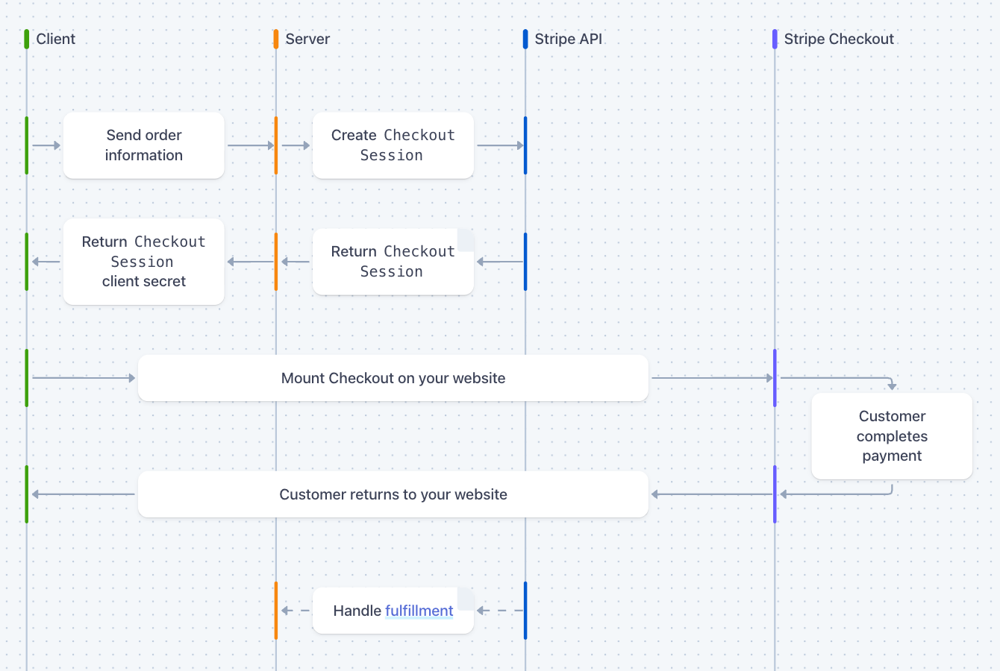

# Integration with third-party systems

## Lecture 5 – Payment with Stripe

---

<!-- Theory -->

# Why not take the card details ourselves?

| Build it yourself | With Stripe |
|---|---|
| Card numbers pass through **our** server | They go straight to Stripe |
| PCI DSS audits and rules | Stripe is certified |
| 3D Secure, declined cards | Built in |
| Swish, Klarna, Apple Pay | Turned on in the Dashboard |
| Refunds, disputes, receipts | Built in |

We **integrate** payment – and never touch a card number.

---

# Three ways to show the payment

| | **Hosted** | **Embedded** | **Elements** |
|---|---|---|---|
| Where the customer pays | On Stripe's page | Stripe's form inside **our** page | Our own form, built from Stripe's fields |
| The customer leaves our site | Yes | No | No |
| Code | Least | A little more | Most |
| `ui_mode` | `hosted_page` (default) | `embedded_page` | `elements` |

Today: **hosted** and **embedded**. Both use the same **Checkout Session**.

---

# Embedded = an iframe from Stripe

```
┌─ our page ─────────────────────────────────┐
│  Cart · header · footer – our React        │
│  ┌─ iframe from Stripe ─────────────────┐  │
│  │ Card number  [ 4242 4242 ... ]       │  │
│  │ [ Pay 997 kr ]                       │  │
│  └──────────────────────────────────────┘  │
└────────────────────────────────────────────┘
```

- Our page only gives Stripe an empty `<div>`
- Our JavaScript **can't read** it – card numbers never reach us
- Styled in the Stripe Dashboard (Branding) – not with our CSS
- Stripe.js is loaded from `js.stripe.com` – `loadStripe()` does it

---

# The Checkout Session

```ts
const session = await stripe.checkout.sessions.create({
  mode: 'payment',
  line_items: [{ quantity: 1, price_data: {
    currency: 'sek',
    unit_amount: 59900, // öre – 599 kr
    product_data: { name: 'Hoodie Svart' },
  } }],
  client_reference_id: order.id, // OUR order
  success_url: `${CLIENT_URL}/return` +
    '?session_id={CHECKOUT_SESSION_ID}',
})
```

- **Hosted** → `session.url`: send the customer there
- **Embedded** → `session.client_secret`: React shows the form

---

# Three keys

| Key | Where | May |
|---|---|---|
| **Secret key** `sk_test_...` | Only the server, `.env` | Create payments, refund, read everything |
| **Publishable key** `pk_test_...` | React – it's public | Only show Stripe's form |
| **Webhook secret** `whsec_...` | Only the server, `.env` | Check that a webhook comes from Stripe |

- `sk_` in React or in git = anyone can make payments in your name
- Test mode and live mode have **different** keys – today we only use test mode

---

# The price is calculated on the server

React sends **what** the customer buys – never the price:

```json
{ "items": [{ "sku": "LEV-1001", "quantity": 2 }] }
```

The server fetches the price from **the database**, by sku or id:

```ts
// SELECT name, price FROM products WHERE sku = $1
const product = await getProductBySku(cartItem.sku)
if (!product) return res.sendStatus(400)
unit_amount: product.price * 100 // kr → öre
```

A price from React can be changed in dev tools – 1 kr for a jacket.

---

<style scoped>section { font-size: 28px; }</style>

# Checkout lifecycle: hosted




Source: [Stripe – How Hosted Checkout works](https://docs.stripe.com/payments/checkout/how-checkout-works?payment-ui=stripe-hosted#lifecycle)

---

<style scoped>section { font-size: 28px; }</style>

# Checkout lifecycle: embedded & elements



Source: [Stripe – How Embedded Checkout works](https://docs.stripe.com/payments/checkout/how-checkout-works?payment-ui=embedded-page#lifecycle)

---

# The payment flow from checkout: hosted & embedded

```
React                     Express                     Stripe
  │  pay now (checkout)      │                           │
  │─────────────────────────►│ 1. create order 'pending' │
  │                          │ 2. create Session ───────►│
  │                url/secret│◄──────────────────────────│
  │◄─────────────────────────│                           │
  │ 3. the customer pays ───────────────────────────────►│
  │                          │◄─ 4. webhook: paid ───────│
  │                          │   order → 'paid'          │
  │ 5. /return?session_id ──────────────────────────────►│
```

Step 4 and step 5 are **independent**. Either one can come first – or step 5 not at all.

---

# Why not mark the order paid on the return page?

```
/return?session_id=cs_test_a1b2c3
```

- **Anyone** can open that URL – without paying
- The customer can close the browser after paying – then the page never loads
- Some payments (bank transfers) are confirmed **later**

The return page only **shows** the status.
**Only the webhook** marks the order as paid – it comes from Stripe, server to server.

---

# Webhooks – Stripe calls us

L1–L4: **we** call the other system (REST).
Now: **the other system calls us** when something happens.

```
Stripe ── POST /api/stripe/webhook ──► Express

{ type: 'checkout.session.completed',
  data: { object: session } }
```

- The URL is **public** – Stripe must be able to reach it
- Answer `200` quickly – otherwise Stripe sends the event again (for up to 3 days)
- The same event can come **more than once** → only mark the order paid once

---

# Anyone can POST to a public URL

```bash
curl -X POST https://your-shop.com/api/stripe/webhook \
  -d '{"type":"checkout.session.completed",
       "data":{"object":{"client_reference_id":"123"}}}'
```

Without a check: order 123 is paid – and no money has been paid.

**Signature verification**: Stripe signs every webhook with the webhook secret.

```ts
const event = stripe.webhooks.constructEvent(
  rawBody,
  req.headers['stripe-signature'],
  WEBHOOK_SECRET,
)
// wrong signature → throws → we answer 400
```

---

# The raw body trap

The signature is calculated on the **bytes** Stripe sent – not on a parsed object.

```ts
// ✗ express.json() first → the bytes are gone
//   → every webhook fails with 400
app.use(express.json())
app.use('/api/stripe/webhook', webhookRouter)
```

```ts
// ✓ the webhook first – its router uses
//   express.raw({ type: 'application/json' })
app.use('/api/stripe/webhook', webhookRouter)
app.use(express.json())
app.use('/api/checkout', checkoutRouter)
```

---

# Handling the event

```ts
switch (event.type) {
  case 'checkout.session.completed':
  case 'checkout.session.async_payment_succeeded': {
    const session = event.data.object
    // a bank transfer isn't paid yet
    if (session.payment_status !== 'paid') break
    const order = findOrder(session.client_reference_id)
    if (order.status === 'paid') break // sent again
    order.status = 'paid' // + lower stock, send email
    break
  }
}
res.json({ received: true })
```

---

# Abandoned orders: the session expires

A Checkout Session **expires** if nobody pays – after 24 hours, or sooner with `expires_at` (at least 30 min).

```ts
case 'checkout.session.expired': {
  const session = event.data.object
  const order = findOrder(session.client_reference_id)
  // never cancel an order that is already paid
  if (order.status !== 'pending') break
  order.status = 'cancelled' // + give back stock
  break
}
```

---

<style scoped>section { font-size: 28px; }</style>

# Abandoned orders: cancel or delete?

**1. The webhook** (the walkthrough)
- Stripe sends `checkout.session.expired` → the order becomes `cancelled`
- Stripe tells us when – no extra job to run

**2. A cleanup job** (cron)
- Runs e.g. every night and **cancels or deletes** `pending` orders older than 24 hours
- Also catches orders whose webhook never arrived – often used as a backup

**Cancel or delete?**
- **Cancel** – the order stays as `cancelled`: it can be traced if a customer asks, shows how many drop off at payment, and can be used for reminder emails
- **Delete** – a smaller table, but the history is gone. Most shops cancel and keep

---

<style scoped>section { font-size: 28px; }</style>

# Abandoned orders: reserved stock

One jacket left – two customers pay at the same time. Who gets it?

- Some shops **reserve** the items when the order is created: the stock goes down already at `pending`, so nobody else can buy them
- Then an abandoned order **blocks** the stock – it must be given back when the session expires
- So these shops **shorten the session** to about 30 minutes (the minimum) instead of 24 hours:
  ```ts
  expires_at: Math.floor(Date.now() / 1000) + 30 * 60,
  ```
- **Without reservation** (the walkthrough): the stock only goes down at `paid` – nothing to give back, but both customers may pay for the last jacket, and one must be refunded
- **Fewer abandoned orders**: reuse the `pending` order if the same customer comes back with the same checkout
---

<style scoped>section { font-size: 28px; }</style>

# Timeouts – all on the server

| | Call | Who controls it |
|---|---|---|
| 1 | Our server → Stripe | **We do** – timeout + retries on the client |
| 2 | The customer pays | **We do** – `expires_at`, 30 min – 24 h |
| 3 | Stripe → our webhook | **Stripe** – we answer 200 quickly |

```ts
const stripe = new Stripe(SECRET_KEY, {
  timeout: 10_000,      // 10 s per try (default 80 s)
  maxNetworkRetries: 2, // then give up → 502
})
```

React only calls **our** server – and it always answers, with a clear 502 if Stripe doesn't.

---

<style scoped>section { font-size: 28px; }</style>

# Webhooks locally: the Stripe CLI

Stripe can't reach `localhost` – the CLI forwards the events.

**1. Install** – once
```bash
brew install stripe/stripe-cli/stripe   # macOS
npm install -g @stripe/cli              # any OS
```

**2. Log in** – once: `stripe login` (opens the browser)

**3. Listen** – every time you test, only our three events
```bash
stripe listen --forward-to \
  localhost:3000/api/stripe/webhook --events \
  checkout.session.completed,\
checkout.session.async_payment_succeeded,\
checkout.session.expired
> Ready! Your webhook signing secret is whsec_...
```
Copy `whsec_...` to `.env` and restart the server.

---

<style scoped>section { font-size: 28px; }</style>

# Locally vs deployed

| | Locally | Deployed |
|---|---|---|
| Sends the webhook | `stripe listen` | Stripe, to your public URL |
| Create it in | Nothing to create | Dashboard → Webhooks |
| `whsec_...` | From `stripe listen` | On the endpoint – a **different** one |

**Test cards** – any future date, any CVC

| Card | Result |
|---|---|
| `4242 4242 4242 4242` | Succeeds |
| `4000 0000 0000 9995` | Declined |

---

# Code walkthrough: `stripe-walkthrough/`

1. Hosted: cart → order `pending` → Checkout Session → `session.url`
2. Embedded: the same order, `ui_mode: 'embedded_page'` → `client_secret` → `<EmbeddedCheckout />`
3. Webhook: `express.raw()` → `constructEvent` → order `paid`
4. Return page: shows the status – never marks the order paid

---

# Labb 3 – Betalning

The third step of Assignment 1: payment in your shop.

- Stripe Checkout, hosted or embedded, in test mode
- The server calculates the price – React only sends the cart
- The order is saved before the payment, and its id follows the payment
- A signature-verified webhook marks the order as paid – only once
- A confirmation page that only shows the status

*(Go through the requirements and "Klart när" in Labb 3)*
